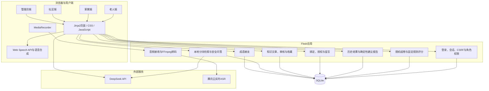
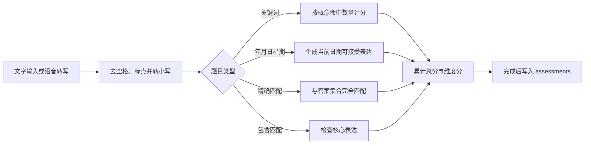
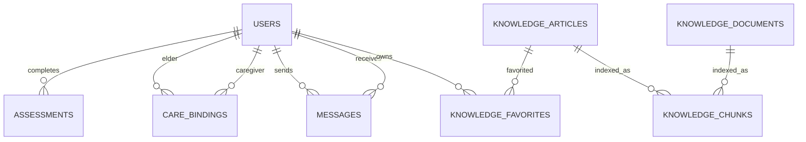

# 忆路明灯项目技术文档

更新日期：2026-08-05

适用范围：当前仓库中的 Flask 原型系统
文档对象：开发人员、测试人员、部署人员和项目交接成员

> “忆路明灯”是面向老年人的多方言语音交互与认知表现辅助评估平台。系统结果仅反映当次任务表现，不属于医疗诊断，不替代标准化量表、医生诊断或专业治疗。

## 1. 文档目的

本文档描述当前项目的技术架构、代码模块、数据结构、主要接口、业务流程、第三方服务、安全边界、测试方法和部署要求。阅读本文档后，开发人员应能够：

- 理解老人端、家属端、社区端和管理员端的权限关系；
- 理解三种语言输入采用的不同技术链路；
- 修改认知题库而不破坏固定维度配额和评分规则；
- 维护用户、测试历史、知识文章、RAG文档和留言数据；
- 在不泄露密钥和敏感数据的前提下运行与部署系统；
- 使用现有自动化测试验证关键业务和权限边界。

## 2. 系统概述

### 2.1 主要能力

当前版本提供以下功能：

- 账号注册、登录、退出、停用和管理员密码重置；
- 老人端、家属端、社区端和后台管理员四类账户；
- 普通话、粤语和潮汕话语音输入，以及文字输入回退；
- 10题随机认知任务、14分固定规则评分和七个能力维度；
- 历史测试记录、维度详情和确定性训练建议报告；
- 老人绑定码、家属/社区授权查看和双方留言；
- 健康知识中心、社区投稿、管理员审核和收藏；
- 带开关、角色过滤和真实来源展示的本地知识库问答；
- 老人端成语接龙小游戏；
- 适老化大字号、大按钮和响应式界面。

### 2.2 技术栈

| 层级 | 技术 | 用途 |
| --- | --- | --- |
| 前端 | HTML、Jinja2、CSS、JavaScript | 页面渲染、适老化交互、录音、语音合成和测试状态展示 |
| Web框架 | Python Flask | 路由、会话、权限、业务编排和模板渲染 |
| 数据库 | SQLite（WAL模式） | 用户、评估、绑定、留言、知识、成语和检索分块 |
| 大模型 | DeepSeek兼容接口 | 普通陪伴对话、基于已审核资料组织知识回答 |
| 普通话语音 | Web Speech API | 浏览器端单句识别，不经过本项目后端ASR接口 |
| 粤语/潮汕话语音 | MediaRecorder、FFmpeg、腾讯云实时ASR | 浏览器录音、音频转码和云端方言识别 |
| 语音朗读 | SpeechSynthesisUtterance | 浏览器端朗读聊天回复、题目和知识文章 |
| 文档解析 | python-docx、pypdf | 管理员导入DOCX和文本型PDF知识文档 |
| 自动化测试 | pytest、pytest-repeat | 功能、权限、评分和知识库回归测试 |

## 3. 总体架构



### 3.1 关键边界

- 腾讯云ASR只负责将粤语或潮汕话音频转写为文本；
- DeepSeek不参与认知题目评分，也不生成诊断结论；
- 认知得分由 `memory_lantern/assessment/` 中的固定规则计算，生活判断题在规则无法理解时可使用低置信度可拒判的本地语义模型；
- 专属建议报告由 `memory_lantern/assessment/reports.py` 根据已保存分数确定性生成；
- SQLite是业务数据与知识内容的权威数据源；
- `knowledge_chunks` 是可重建的派生检索索引，不是权威原文；
- 已完成测试写入数据库，进行中的测试和游戏仍保存在Flask进程内存中。

## 4. 项目目录与模块职责

```text
忆路明灯/
├─ app.py                 Flask应用入口、路由、权限和业务编排
├─ memory_lantern/
│  ├─ assessment/         题库、回答清洗、安全/语义评分、语音指标和报告
│  ├─ drawing/            绘图特征、实验模型加载和低置信度拒判
│  ├─ knowledge/          内置知识、知识分块、检索和带出处回答
│  ├─ games/              成语解析、首尾校验、提示和电脑回合
│  ├─ integrations/       腾讯云实时ASR签名、WebSocket发送和结果解析
│  ├─ persistence/        SQLite建表、兼容迁移、种子导入和数据访问
│  └─ core/               国际化与研究结果展示
├─ requirements.txt       运行依赖
├─ requirements-dev.txt   日常开发和自动化测试依赖
├─ requirements-ml.txt    可选本地模型依赖
├─ requirements-benchmark.txt 数据集与性能基准测试依赖
├─ ffmpeg.exe             Windows音频转码程序
├─ ffprobe.exe            Windows音频信息工具
├─ templates/             Jinja2页面模板
├─ static/app.css         全站样式、角色主题与响应式适配
├─ data/idioms_seed.txt   四字成语种子数据
├─ data/*.db              本地数据库（不得提交或随公开代码包发送）
├─ tests/                 自动化测试、性能脚本和测试说明
└─ docs/                  配置、交接和技术文档
```

### 4.1 `app.py`

负责：

- 加载 `.env` 和初始化Flask；
- 创建DeepSeek客户端；
- 设置Cookie、会话有效期、上传大小和数据库路径；
- 生成并验证CSRF令牌；
- 加载当前用户并处理停用账户；
- 提供登录、注册、角色权限装饰器和对象级授权；
- 编排知识、聊天、语音、测试、报告、绑定、留言和游戏路由；
- 将进行中的测试保存在 `TEST_SESSIONS`；
- 将进行中的成语接龙保存在 `IDIOM_GAME_SESSIONS`。

### 4.2 `database.py`

负责：

- 创建SQLite表和索引；
- 开启外键和WAL日志模式；
- 对旧数据库补充 `account_type`、`binding_code`、`question_bank_version` 和 `question_ids`；
- 为旧普通用户迁移老人端账户类型并补发绑定码；
- 按版本导入成语与内置知识文章；
- 封装所有业务数据的查询和写入。

### 4.3 `questions.py`

负责随机生成固定结构的10题测试，并对回答进行确定性评分。题库版本为：

```text
random-cognitive-bank-v1
```

### 4.4 `reports.py`

根据总百分比和各维度得分生成：

- 整体表现说明；
- 相对稳定维度；
- 最多三个优先练习维度；
- 对应训练活动卡；
- 一周参考安排；
- 一般性健康行动；
- 后续观察、就医和紧急情况提醒。

该模块不调用大模型，生成结果可复现。

### 4.5 `rag.py`

当前RAG实现不使用向量数据库或外部Embedding服务，而是：

1. 将已发布文章和文档按段落切分，目标块长约460字并保留55字重叠；
2. 提取中文二元、三元字符片段及英文数字词元；
3. 对标题、摘要、关键词和正文交集进行加权评分；
4. 按用户角色过滤资料；
5. 最多选择4个不同来源；
6. 将命中片段交给DeepSeek组织成易懂回答；
7. 返回标题、来源机构、链接和章节作为引用；
8. 对紧急关键词优先返回固定急诊提示；
9. 无可靠资料时固定拒答，不让模型自行补充医学事实。

### 4.6 `tencent_asr.py`

负责生成腾讯云ASR WebSocket签名，将16 kHz、16 bit、单声道PCM按约1:1实时速度分块发送，并拼接稳定识别结果。

## 5. 角色与权限模型

### 5.1 账户字段

系统用两个字段共同决定权限：

- `role`：`member` 或 `admin`；
- `account_type`：`elder`、`family`、`community` 或 `admin`。

公开注册只允许创建 `elder`、`family` 和 `community`，并固定为 `member`，不会自动获得管理员权限。

### 5.2 权限矩阵

| 能力 | 老人端 | 家属端 | 社区端 | 管理员 |
| --- | :---: | :---: | :---: | :---: |
| 认知测试 | 是 | 否 | 否 | 是 |
| 查看本人历史 | 是 | 不适用 | 不适用 | 是 |
| 查看已绑定老人历史 | 不适用 | 是 | 是 | 是 |
| 成语接龙 | 是 | 否 | 否 | 是 |
| 健康知识浏览 | 是 | 是 | 是 | 是 |
| 社区知识投稿 | 否 | 否 | 是 | 否 |
| 知识审核与发布 | 否 | 否 | 否 | 是 |
| RAG文档管理 | 否 | 否 | 否 | 是 |
| 用户启停与密码重置 | 否 | 否 | 否 | 是 |
| 家属—社区留言 | 否 | 是 | 是 | 管理用途 |

### 5.3 对象级授权

- 老人只能查看自己的结果；
- 家属或社区必须通过老人绑定码建立 `care_bindings` 关系；
- 解除绑定后立即失去该老人历史与报告的访问权限；
- 家属与社区只有共同绑定同一位老人时才能互相留言；
- 管理员可以查看用户历史，但公开注册无法创建管理员；
- 知识文章和RAG文档必须同时满足“已发布”和“当前角色可见”才能被检索或展示。

## 6. 认知测试设计

### 6.1 组卷结构

每次测试固定10题、满分14分：

| 维度 | 每次题数 | 最高分 | 判分方式 |
| --- | ---: | ---: | --- |
| 即时记忆 | 1 | 3 | 每个目标概念1分 |
| 延迟记忆 | 1 | 3 | 使用首题相同词组，每个目标概念1分 |
| 时间定向 | 3 | 3 | 与当前年月日或星期可接受表达匹配 |
| 注意力 | 2 | 2 | 标准化后精确匹配 |
| 计算能力 | 1 | 1 | 标准化后精确匹配 |
| 语言能力 | 1 | 1 | 包含可接受核心表达 |
| 日常判断 | 1 | 1 | 包含合理处置关键词 |

第一题始终是即时记忆，最后一题始终是同一词组的延迟记忆；中间8题按固定配额抽取后随机排序。

### 6.2 判分流程



### 6.3 表现层级

| 百分比 | 界面提示 |
| ---: | --- |
| ≥ 80% | 本次认知任务表现较稳定 |
| 60%～79% | 本次部分任务存在困难，建议休息后再次测试 |
| < 60% | 本次多项任务存在困难，建议由家属陪同进行专业评估 |

这些阈值仅用于原型界面反馈，不是疾病诊断分界值。

### 6.4 数据最小化

测试完成后保存：

- 总分、满分、百分比和表现层级；
- 各维度得分；
- 输入语言；
- 题库版本和本次题目ID；
- 描述性语音行为汇总，包括样本数、首次发声、停顿、有效说话时长和有声占比；
- 完成时间。

数据库不保存：

- 原始录音；
- 完整语音识别文本；
- 每道题的原始回答。

## 7. 语音链路

### 7.1 普通话

```text
浏览器麦克风
  → Web Speech API（zh-CN）
  → 转写文本
  → 用户输入框/聊天或测试流程
```

普通话识别发生在浏览器中，不调用 `/speech/recognize`，能力和可用性取决于浏览器、系统语言服务、站点麦克风权限和网络环境。

在认知测试模式下，浏览器会同时使用 `MediaRecorder` 生成临时WebM录音并调用 `/speech/analyze`。后端转为PCM后提取描述性特征，处理结束即删除临时文件。该流程不改变Web Speech API的转写结果。

### 7.2 粤语与潮汕话

```text
MediaRecorder录制WebM
  → POST /speech/recognize
  → 临时目录保存录音
  → FFmpeg转换为16 kHz、16 bit、单声道PCM
  → 腾讯云WebSocket实时ASR
  → 从同一PCM提取停顿与时长特征
  → 返回稳定文本
  → 临时目录自动删除
```

默认引擎映射：

| 语言 | 表单值 | 默认引擎 |
| --- | --- | --- |
| 粤语 | `cantonese` | `16k_yue` |
| 潮汕话 | `chaoshan` | `TENCENT_ASR_ENGINE_CHAOSHAN`，未设置时回退到 `TENCENT_ASR_ENGINE` |

### 7.3 失败状态

| 状态码 | 典型原因 |
| ---: | --- |
| 400 | 未上传音频、语言非法或音频转码失败 |
| 422 | 没有识别到清晰语音 |
| 502 | 腾讯云ASR错误或连接失败 |
| 503 | 腾讯云密钥未配置 |
| 504 | FFmpeg转码超时 |

### 7.4 语音行为观察

当前采用轻量RMS语音活动检测，不使用认知风险分类模型。每30毫秒计算一帧能量，阈值结合环境底噪和本次峰值自适应确定；持续500毫秒以上、且位于首次与末次发声之间的静音记为长停顿。

保存特征包括：录音时长、有效说话时长、静音时长、开录后首次发声时间、长停顿次数及总时长、有声占比、转写字符数和近似每分钟字符数。历史报告只做描述，不把这些数值解释为认知障碍，也不把它们加入原有测试分数。

## 8. 智慧陪伴与知识库

### 8.1 普通陪伴模式

`POST /chat` 接收不超过2000字的消息。关闭知识库，或输入被识别为简单寒暄时，系统直接调用DeepSeek并要求其使用简短、温和、适合老人的中文回复。

### 8.2 知识库模式

开启知识库时：

- 紧急表达先经过固定关键词检查；
- 只从已发布且当前角色有权查看的资料检索；
- 没有足够依据时返回固定提示；
- 有命中资料时，DeepSeek只能依据提供片段作答；
- 输出包含真实资料编号、标题、来源机构和来源链接；
- 回答必须提示不替代医生意见；
- 认知测试评分不使用知识库。

### 8.3 文档导入

管理员可导入：

- `.txt`；
- `.md`；
- `.docx`；
- 有文本层且未加密的 `.pdf`。

应用请求最大为10 MB。系统保存提取后的正文、来源、状态和分块，不保存原始上传文件。扫描版PDF需要先做OCR。

## 9. 数据库设计

默认数据库位置：

```text
data/memory_lantern.db
```

SQLite连接启用：

```sql
PRAGMA foreign_keys = ON;
PRAGMA journal_mode = WAL;
```

### 9.1 数据表

| 表 | 主要用途 | 关键字段 |
| --- | --- | --- |
| `users` | 用户、角色和账户状态 | `username`、`password_hash`、`role`、`account_type`、`binding_code`、`is_active` |
| `assessments` | 已完成认知测试 | `test_session_id`、`user_id`、`score`、`domain_scores`、`input_language`、`question_ids`、`speech_metrics` |
| `care_bindings` | 家属/社区与老人授权关系 | `elder_id`、`caregiver_id`、`created_at` |
| `messages` | 家属与社区留言 | `elder_id`、`sender_id`、`recipient_id`、`body`、`is_read` |
| `idioms` | 成语接龙词库 | `word`、`first_char`、`last_char`、`is_active` |
| `knowledge_articles` | 内置文章与社区投稿 | `title`、`content`、`audience`、`status`、`source_url`、审核字段 |
| `knowledge_favorites` | 用户收藏关系 | `user_id`、`article_id` |
| `knowledge_documents` | 管理员导入知识文档 | `document_id`、`content`、`content_hash`、`status`、`chunk_count` |
| `knowledge_chunks` | 可重建检索分块 | `source_type`、`source_id`、`content`、`vector_id` |
| `app_metadata` | 种子数据版本 | `key`、`value` |

### 9.2 主要关系



### 9.3 种子数据

- `data/idioms_seed.txt` 按 `IDIOM_SEED_VERSION` 导入成语表；
- `knowledge_seed.py` 按 `KNOWLEDGE_SEED_VERSION` 导入内置健康文章；
- 版本记录保存在 `app_metadata`；
- 使用 `INSERT OR IGNORE` 或基于唯一标识更新，重复启动不会重复插入。

## 10. 主要页面和接口

### 10.1 页面路由

| 路由 | 方法 | 权限 | 功能 |
| --- | --- | --- | --- |
| `/login` | GET/POST | 未登录 | 登录 |
| `/register` | GET/POST | 未登录 | 注册老人、家属或社区账户 |
| `/dashboard` | GET | 登录 | 分角色首页 |
| `/assistant` | GET | 老人/管理员 | 陪伴聊天和认知测试 |
| `/history` | GET | 老人/管理员 | 本人历史结果 |
| `/elders/<id>/history` | GET | 已授权家属/社区/管理员 | 老人历史结果 |
| `/history/<id>` | GET | 对象级授权 | 测试详情 |
| `/history/<id>/report` | GET | 对象级授权 | 专属建议报告 |
| `/knowledge` | GET | 登录 | 知识中心、搜索和收藏筛选 |
| `/knowledge/<id>` | GET | 角色可见 | 知识详情 |
| `/knowledge/submissions` | GET | 社区端 | 社区投稿列表 |
| `/admin/knowledge` | GET | 管理员 | 文章审核与管理 |
| `/admin/rag-documents` | GET | 管理员 | RAG文档管理 |
| `/admin/users` | GET | 管理员 | 用户管理 |
| `/messages` | GET/POST | 家属/社区 | 共同绑定关系留言 |
| `/games/idiom` | GET | 老人/管理员 | 成语接龙页面 |

### 10.2 JSON与文件接口

所有POST接口都需要CSRF令牌。JSON和文件接口通过请求头发送：

```http
X-CSRF-Token: <当前会话令牌>
```

HTML表单使用：

```text
_csrf_token=<当前会话令牌>
```

#### `POST /chat`

请求：

```json
{
  "message": "如何帮助老人保持规律作息？",
  "use_knowledge": true
}
```

成功响应的主要字段：

```json
{
  "reply": "回答文本",
  "references": [],
  "knowledge_used": false,
  "urgent": false
}
```

#### `POST /speech/recognize`

类型：`multipart/form-data`

| 字段 | 类型 | 说明 |
| --- | --- | --- |
| `audio` | 文件 | 浏览器录制的WebM音频 |
| `language` | 文本 | `cantonese` 或 `chaoshan` |

成功响应：

```json
{
  "text": "识别文本",
  "language": "cantonese",
  "speech_observation": {
    "valid": true,
    "pause_count": 1,
    "speech_duration_ms": 2100
  }
}
```

#### `POST /speech/analyze`

类型：`multipart/form-data`。用于测试模式下的普通话浏览器录音。

| 字段 | 类型 | 说明 |
| --- | --- | --- |
| `audio` | 文件 | 浏览器临时WebM音频 |
| `transcript` | 文本 | 浏览器转写结果，仅用于计算近似语速，不写入数据库 |

成功时返回 `speech_observation`。接口不会保存音频、转写文本或医学判断结果。

#### `POST /test/start`

```json
{
  "input_language": "browser"
}
```

`input_language` 可取 `browser`、`cantonese` 或 `chaoshan`。

#### `POST /test/answer`

```json
{
  "message": "用户当前回答"
}
```

系统不向浏览器返回标准答案或当前得分；完成第10题后才保存并返回结果摘要。

#### 成语接龙接口

| 接口 | 请求 | 作用 |
| --- | --- | --- |
| `POST /games/idiom/start` | 空JSON或无业务字段 | 创建游戏状态并返回电脑首个成语 |
| `POST /games/idiom/play` | `{"idiom":"一帆风顺"}` | 校验成语并生成电脑回合 |
| `POST /games/idiom/reset` | 空JSON或无业务字段 | 清除当前游戏状态 |

## 11. 配置项

复制 `.env.example` 为 `.env`，只在本地填写真实值。

| 变量 | 必需 | 默认值/说明 |
| --- | :---: | --- |
| `DEEPSEEK_API_KEY` | 聊天必需 | DeepSeek密钥，不得提交 |
| `DEEPSEEK_BASE_URL` | 否 | `https://api.deepseek.com` |
| `DEEPSEEK_MODEL` | 否 | 当前代码默认 `deepseek-v4-flash` |
| `FLASK_SECRET_KEY` | 生产必需 | 会话签名密钥；不得使用代码中的开发回退值 |
| `DATABASE_PATH` | 否 | 留空时使用 `data/memory_lantern.db` |
| `SESSION_COOKIE_SECURE` | 否 | 本地HTTP为 `false`；生产HTTPS为 `true` |
| `TENCENT_ASR_APP_ID` | 方言必需 | 腾讯云AppID |
| `TENCENT_ASR_SECRET_ID` | 方言必需 | 腾讯云SecretID |
| `TENCENT_ASR_SECRET_KEY` | 方言必需 | 腾讯云SecretKey |
| `TENCENT_ASR_ENGINE` | 否 | 默认 `16k_zh_en` |
| `TENCENT_ASR_ENGINE_CHAOSHAN` | 否 | 潮汕话引擎覆盖配置 |
| `TENCENT_ASR_ENGINE_CANTONESE` | 否 | 默认 `16k_yue` |

示例只写变量名，不写真实密钥：

```dotenv
DEEPSEEK_API_KEY=替换为本地密钥
DEEPSEEK_BASE_URL=https://api.deepseek.com
DEEPSEEK_MODEL=deepseek-v4-flash
FLASK_SECRET_KEY=替换为随机长字符串
DATABASE_PATH=
SESSION_COOKIE_SECURE=false
TENCENT_ASR_APP_ID=替换为AppID
TENCENT_ASR_SECRET_ID=替换为SecretID
TENCENT_ASR_SECRET_KEY=替换为SecretKey
TENCENT_ASR_ENGINE=16k_zh_en
TENCENT_ASR_ENGINE_CHAOSHAN=16k_zh_en
TENCENT_ASR_ENGINE_CANTONESE=16k_yue
```

## 12. 本地开发

### 12.1 环境要求

- Windows 10/11；
- Python 3.10或更高版本；
- Microsoft Edge或Google Chrome；
- 可用物理麦克风；
- DeepSeek和腾讯云网络访问能力；
- 项目根目录中的 `ffmpeg.exe` 和 `ffprobe.exe`。

### 12.2 安装

```powershell
python -m venv .venv
Set-ExecutionPolicy -Scope Process Bypass
.\.venv\Scripts\Activate.ps1
python -m pip install --upgrade pip
python -m pip install -r requirements.txt
Copy-Item .env.example .env
```

### 12.3 启动

```powershell
python app.py
```

浏览器访问：

```text
http://127.0.0.1:5000
```

当前入口启用了Flask调试服务器，只适合本地开发。

## 13. 测试

### 13.1 安装测试依赖

```powershell
python -m pip install -r tests/requirements-test.txt
```

### 13.2 快速回归

```powershell
python -m pytest -c tests/pytest.ini
```

### 13.3 每例重复三次并生成JUnit结果

```powershell
python -m pytest -c tests/pytest.ini --count=3 `
  --junitxml=tests/results/functional_results.xml
```

现有自动化覆盖：

- 10,000套随机试卷结构一致性；
- 账号注册、登录和密码规则；
- 不同角色首页和访问权限；
- 10题完成、满分评分和历史保存；
- 报告规则；
- 绑定前、绑定后和解绑后的对象授权；
- 管理员页面访问控制；
- 家属与社区留言权限；
- 知识文章、RAG检索、紧急提示和异常处理。

真实浏览器性能、真实语音识别和用户体验测试位于 `tests/benchmarks/`，执行方法见 `tests/README.md`。自动化测试中的DeepSeek和腾讯云请求使用模拟对象，不能替代真实语音实验数据。

## 14. 安全与隐私

### 14.1 已实现措施

- 密码使用Werkzeug安全哈希存储；
- 用户名使用SQLite不区分大小写唯一约束；
- Cookie设置 `HttpOnly` 和 `SameSite=Lax`；
- 所有POST请求需要CSRF令牌；
- 登录后按角色和对象关系双重授权；
- 禁止外部 `next` URL跳转；
- 停用账号会自动清除登录会话；
- 知识来源链接仅接受完整HTTP/HTTPS地址；
- 单次上传限制10 MB；
- 不保存方言原始录音和认知原始回答；
- RAG只使用已发布资料，并按角色过滤；
- 紧急表达使用固定提示，不交给模型自由判断；
- 公开注册不能创建管理员。

### 14.2 生产前必须补充

- 关闭Flask `debug=True`；
- 使用HTTPS并启用安全Cookie；
- 增加登录、绑定码和留言接口频率限制；
- 增加管理员操作和敏感数据访问审计；
- 建立用户授权、撤回、数据导出和删除流程；
- 建立数据库迁移、备份、恢复和保留期限；
- 为知识审核增加版本回滚、来源失效检查和双人复核；
- 对上传内容进行更完整的恶意文件和隐私信息检查；
- 轮换所有曾在聊天、截图或仓库中出现过的密钥。

### 14.3 打包排除项

发送代码包或提交Git前必须排除：

```text
.env
语音秘钥.csv
deepseek秘钥.txt
data/*.db
data/*.db-wal
data/*.db-shm
temp_record.*
__pycache__/
.venv/
```

## 15. 部署建议

### 15.1 当前限制

当前版本存在以下部署限制：

- 使用Flask开发服务器；
- 进行中的测试和游戏保存在单进程内存；
- SQLite适合原型和轻量单机使用，不适合多实例并发写入；
- `FFMPEG_PATH` 固定指向项目目录中的 `ffmpeg.exe`，直接部署到Linux前必须适配系统FFmpeg路径；
- 本地数据库文件需要持久磁盘，否则平台重启后可能丢失数据。

### 15.2 Windows演示部署

推荐使用Waitress作为WSGI服务器，并将数据库放在受控持久目录。Waitress尚未列入当前 `requirements.txt`，正式使用前需要新增依赖并完成回归测试。

### 15.3 Render或Linux部署

部署到Render或其他Linux平台前至少需要：

1. 关闭调试模式并提供WSGI启动入口；
2. 安装Gunicorn等生产服务器；
3. 安装系统FFmpeg并修改代码，使其从环境变量或PATH读取；
4. 使用PostgreSQL替代SQLite，或者配置持久磁盘并接受单实例限制；
5. 配置所有环境变量，不能上传 `.env`；
6. 使用HTTPS并设置 `SESSION_COOKIE_SECURE=true`；
7. 将测试/游戏状态迁移到数据库或共享缓存，才能安全扩展到多进程；
8. 完成备份恢复、日志脱敏和健康检查。

## 16. 日志与异常处理

- 聊天异常使用Flask日志记录堆栈，但响应只返回通用错误；
- 腾讯云ASR异常转换为 `TencentASRError`；
- 音频转码、ASR连接和识别为空使用不同HTTP状态码；
- 当前部分语音错误仍使用 `print` 输出，生产环境应改为结构化日志；
- 日志不得包含SecretKey、完整录音、老人原始回答或不必要的健康提问原文；
- 建议为每次请求增加匿名请求ID，但不要用请求ID反推出用户身份。

## 17. 已知技术债务

| 优先级 | 问题 | 影响 | 建议 |
| --- | --- | --- | --- |
| P0 | 认知测试中的方言转写仍可能直接进入评分 | 识别错误可能改变得分 | 增加“确认、修改、重录”后再提交 |
| P0 | 潮汕话混合方言识别准确率不稳定 | 用户体验和评分可靠性受影响 | 建立授权语料集并进行引擎A/B测试 |
| P1 | 测试和游戏进行状态保存在进程内存 | 重启或多进程时丢失 | 持久化到数据库或共享缓存 |
| P1 | SQLite迁移通过启动时代码完成 | 复杂升级难回滚 | 引入Alembic/Flask-Migrate或版本化迁移脚本 |
| P1 | Flask调试服务器 | 不适合生产 | 使用生产WSGI服务器 |
| P1 | FFmpeg路径限定Windows文件名 | Linux部署失败 | 增加 `FFMPEG_PATH` 环境变量和PATH探测 |
| P2 | RAG为词面检索 | 同义表达召回有限 | 在保持权限和引用边界的前提下增加可重建向量索引 |
| P2 | 管理审计不完整 | 难追踪敏感操作 | 增加登录、绑定、审核和导出审计 |
| P2 | 成语库含生僻词 | 老人游戏体验不稳定 | 增加常用度字段和优先级策略 |

## 18. 开发规范

### 18.1 修改认知题库

- 保持每次10题和14分总分不变，除非同步修改报告、历史兼容和测试；
- 即时记忆和延迟记忆必须使用同一组词；
- 新题必须包含稳定唯一的 `id`；
- 题目答案只保存在服务端；
- 修改题库结构时提高 `QUESTION_BANK_VERSION`；
- 扩充方言同义表达时不得静默扩大医学判断边界；
- 完成后运行 `test_01_program_consistency.py` 和核心业务测试。

### 18.2 修改数据库

- 先备份本地数据库；
- 不要通过删除数据库来完成正式升级；
- 新字段应提供旧数据默认值和可重复执行的迁移；
- 外键、唯一约束和索引需同步设计；
- 派生索引应可从权威数据重建；
- 更新本技术文档的数据表说明。

### 18.3 修改知识库

- 资料必须有可核验来源；
- 仅已发布资料可进入普通用户检索；
- 社区投稿必须经过管理员审核；
- 不将未审核内容发送给外部模型；
- 不记录无必要的老人原始提问；
- 必须保留“无依据时拒答”和紧急固定提示；
- 变更检索算法后验证角色隔离与引用正确性。

### 18.4 修改接口

- 保持未登录返回401、无权限返回403、对象不存在返回404的语义；
- 所有新增POST接口必须接入CSRF；
- JSON错误响应统一使用 `{"error":"..."}`；
- 不在响应中返回标准答案、密码哈希、密钥或内部异常堆栈；
- 新增接口后补充权限测试和本文档接口表。

## 19. 验收清单

### 19.1 基础功能

- 新账号可以注册、登录和退出；
- 重复用户名和弱密码被拒绝；
- 老人端可以完成10题并在历史中查看结果；
- 家属/社区绑定前不能查看老人结果，绑定后可以，解绑后立即失效；
- 共同绑定同一老人时家属与社区可以留言；
- 管理员可以审核知识和管理用户；
- 普通用户不能进入管理页面。

### 19.2 语音

- Edge/Chrome获得真实物理麦克风权限；
- 普通话浏览器识别可以返回文本；
- 粤语正确映射到粤语引擎；
- 潮汕话正确映射到配置引擎；
- 空音频、静音、转码失败和云端异常均有明确提示；
- 原始录音不会保存在数据库或项目目录。
- 三种语言的语音回答均可生成同结构的描述性停顿统计；
- 语音统计不会改变认知测试得分或生成疾病判断。

### 19.3 认知与报告

- 每次固定10题、14分和七个维度；
- 首末记忆词组一致；
- 测试中不提示对错；
- 完成后只保存结构化最小数据；
- 报告内容随维度得分变化且不调用大模型；
- 页面持续显示非医疗诊断声明。

### 19.4 知识库

- 关闭开关时不检索知识库；
- 开启时只返回当前角色可见的已发布资料；
- 引用标题、机构和链接来自真实数据库记录；
- 未命中资料时拒绝编造；
- 紧急关键词触发固定提示；
- 停用文档重建索引后不再被检索。

## 20. 相关文档

- `docs/项目配置与运行说明.md`：面向新电脑和队员的配置、启动与常见问题；
- `docs/项目任务交接与下一步计划.md`：当前完成情况、已知问题和后续优先级；
- `tests/README.md`：自动化、性能、语音与用户体验测试方法；
- `data/IDIOM_DATA_LICENSE.md`：成语词库来源和许可证。

本技术文档描述的是当前原型代码，不代表系统已经取得医疗器械资质或临床筛查效度。任何面向真实用户的医疗相关研究都应在伦理审批、知情同意和专业机构指导下开展。
